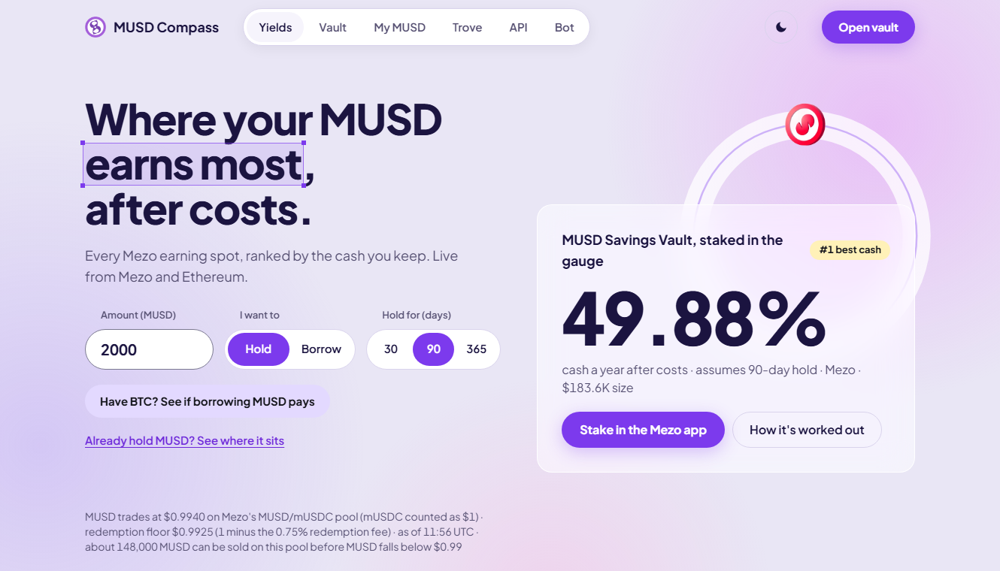
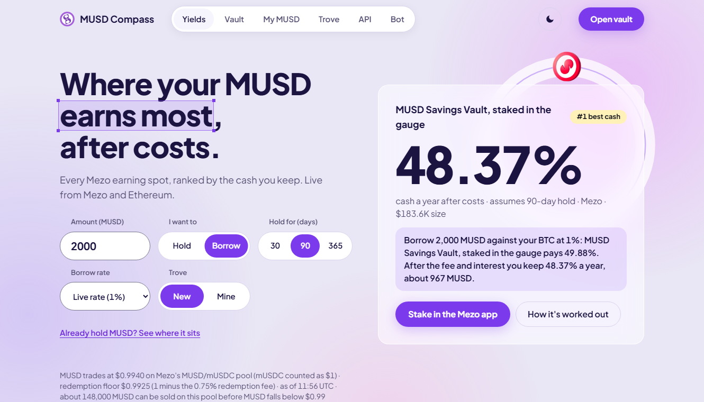
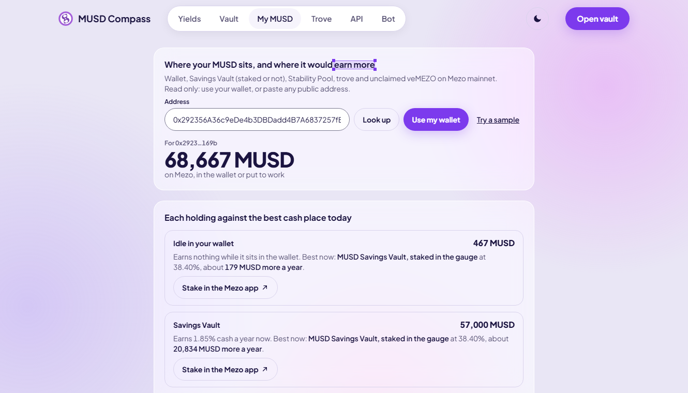
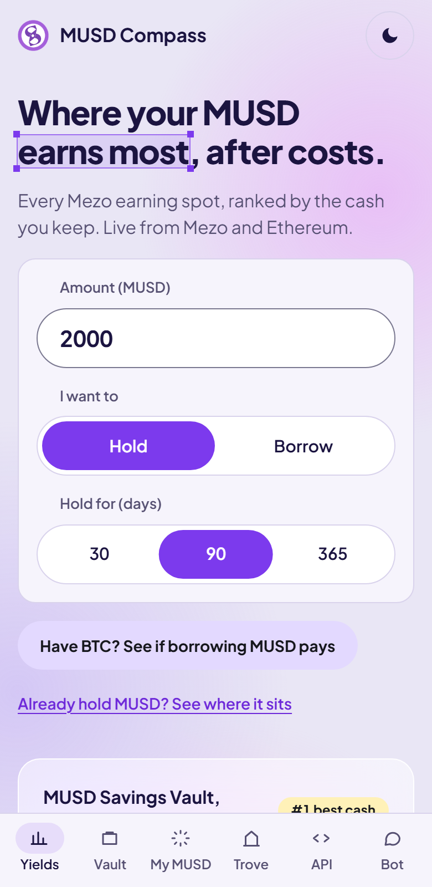
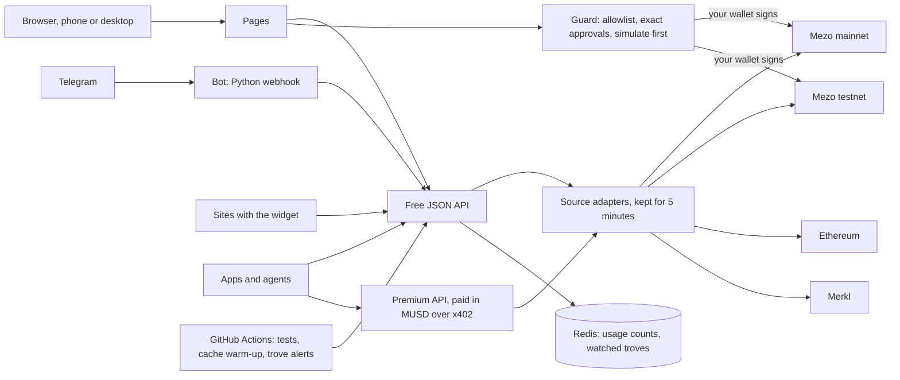

# MUSD Compass

Where does your MUSD earn the most after costs? Compass ranks every place Mezo MUSD can earn, on Mezo and Ethereum, by the cash you keep, with locked veMEZO 🔒 shown beside that figure and left out of it. It runs as a phone web app, a Telegram bot, a one-tag widget, a free JSON API and a pay-per-call x402 API.

**Mezo Buildathon, Wave 2** · Track 1 (DeFi) and Track 2 (Access & Distribution) · no contract of its own, no custody, no keys.

Built on Mezo: MUSD, the Savings Vault (sMUSD) and its gauge, troves (BorrowerOperations, TroveManager, HintHelpers), veMEZO rewards, the Mezo pools, and MUSD payments over x402. New since Wave 1: real mainnet transactions, trove alerts, top-up and repay, gauge staking, WalletConnect ([what changed](#new-in-wave-2)).

| | |
|---|---|
| **Live app** | [musd-compass.vercel.app](https://musd-compass.vercel.app) (works on a phone, no wallet needed) |
| **Demo video (2 min)** | [Watch on YouTube](https://www.youtube.com/watch?v=MzgrWvwby00) |
| **Deck** | [musd-compass-deck.pdf](https://musd-compass.vercel.app/musd-compass-deck.pdf) (also [in the repo](docs/submission/musd-compass-deck.pdf)) |
| **Telegram bot** | [@musd_compass_bot](https://t.me/musd_compass_bot) |
| **API and widget** | [/developers](https://musd-compass.vercel.app/developers) |
| **New in Wave 2** | [Summary below](#new-in-wave-2) · [FEEDBACK-RESPONSE.md](FEEDBACK-RESPONSE.md): the Wave 1 review answered point by point |
| **Usage stats** | [/stats](https://musd-compass.vercel.app/stats): bot users, outside payers, widget sites and API requests, with the date counting began |
| **Proof** | [Mainnet table](#mainnet-proof) · [testnet table](#testnet-proof) · [live /proof page](https://musd-compass.vercel.app/proof) · [all evidence](docs/evidence.md) |

## Try it in 60 seconds

No wallet, no keys, no sign-up.

1. Open the [app](https://musd-compass.vercel.app). The top card is where 2,000 MUSD earns the most cash a year after costs. Change the amount, or switch to *Borrow*, and the list re-ranks.
2. [/my](https://musd-compass.vercel.app/my) → *Try a sample*: a real address's MUSD, each holding next to the best cash place for it.
3. [/vault](https://musd-compass.vercel.app/vault) → *Try to break it*: four attacks, each refused for real, with no wallet.
4. [/proof](https://musd-compass.vercel.app/proof): every transaction Compass has sent, on Mezo mainnet and testnet, each linked to the explorer.

Run it locally:

```
cd web && npm ci && npm run dev        # http://localhost:3000
cd bot && python -m pip install -r requirements.txt && python -m pytest -q
```

Bot without the webhook (needs your own bot token; delete the webhook first):

```
cd bot && TELEGRAM_BOT_TOKEN=... COMPASS_API_URL=http://localhost:3000 python compass_bot.py --poll
```

Telegram commands: `/yield [amount]`, `/carry <amount> [borrow]`, `/vault <address>`, `/rewards <address>`, `/trove <address|sample>`, `/help`, plus six buttons.

The longer walk-through is [For judges](#for-judges-60-seconds-no-wallet-no-keys) below.

## What it looks like



| Borrow mode | My MUSD (sample address) | Phone |
|---|---|---|
|  |  |  |

## The problem

MUSD can earn in the Savings Vault, the Stability Pool, six Mezo pools and Mezo-paid pools on Ethereum. Each shows a different number, and the biggest numbers mislead.

veMEZO rewards stay locked for 12 weeks, so a large APR can be mostly lock and very little cash. Costs eat small deposits: an Ethereum pool needs a bridge round trip and gas both ways, and borrowed MUSD carries trove interest, a 0.1% fee and a 1,800 MUSD minimum. The best place also moves. Overnight from 24 to 25 Oct 2026 the Uniswap V4 veMEZO APR went from 49.8% to 79.9% while MEZO rose 60%.

On a phone, Mezo's own app asks for a larger window (checked 26 Oct). No screen answered "after costs, where do I keep the most cash?"

## Who it is for, and why they come back

- MUSD holders want to know where MUSD earns most after costs, and whether what they already hold could earn more. *My MUSD* shows, for example, that sMUSD staked in the vault gauge earns about 1.34% in MEZO while the unstaked vault pays 4.01%.
- BTC holders want to know whether borrowing MUSD is worth it at all. A yes means more MUSD gets minted.
- Builders and agents get the same numbers through a free API, a widget and a premium call paid in MUSD.

People come back because Mezo's reward campaigns renew every 7 days and rates jump, so the best place for the same MUSD changes from week to week.

## What Compass does

| Feature | What you get |
|---|---|
| **Net-carry ranking** | 13 venues, ranked by cash after costs, hold or borrow, 30 / 90 / 365 days. Every number states its assumption and source, and a source that is down reads "unavailable". |
| **Before you go in** | For your amount and hold: the MUSD you keep, the one-off costs, and the day they are earned back. |
| **Have BTC?** | The spread between the live borrow rate and the vault, after the fee and interest, in one line. |
| **My MUSD** | Any address's wallet, Savings Vault (staked or not), Stability Pool, trove and unclaimed veMEZO, each against the best place for that amount. |
| **Break-even** | The amount range where an Ethereum pool beats the Savings Vault. |
| **Vault, testnet and mainnet** | Deposit, claim and withdraw on the real Savings Vault contracts on Mezo testnet or mainnet. On mainnet also stake, unstake and claim MEZO in the gauge. *Borrow → Earn* opens a trove at 200% and deposits the MUSD; top-up and repay show the ratio before and after. Mainnet actions wait behind a typed-amount confirmation and a 2,500 MUSD limit. |
| **Try to break it** | Four attacks run live with no wallet, and Compass or the chain refuses each one. |
| **Rewards check** | Unclaimed veMEZO for any address from Mezo's Merkl campaigns, with the reallocation warning. |
| **Trove planner** | A mainnet trove's ratio, its own rate, redemption-queue position, and how much more it can borrow at 200% or above. |
| **Trove alerts** | `/watch` in the Telegram bot checks a trove on a schedule and sends an alert when its advice changes. |
| **Proof and stats** | `/proof` lists every transaction Compass has sent. `/stats` shows usage counts with their start date. |
| **Everywhere** | Phone web app (light and dark) · Telegram bot with six buttons · one-tag widget · free JSON API · paid x402 API. |

## Built in Wave 1

- **The ranking and calculator.** Every MUSD venue on Mezo and Ethereum, ranked by cash after costs, hold or borrow, for 30, 90 or 365 days. Locked veMEZO sits beside the cash figure and is never added to it.
- **Before you go in, and break-even.** What your amount keeps, the one-off costs, the day they are earned back, and the amount where an Ethereum pool starts to beat the Savings Vault.
- **Savings Vault on Mezo testnet.** Approve the exact amount, deposit, claim and withdraw, plus *Borrow → Earn*: open a trove at 200% and deposit the MUSD.
- **My MUSD, trove planner, rewards check.** Any address's holdings against the best place for them, a trove's ratio and redemption-queue position, and unclaimed veMEZO.
- **Try to break it.** Attacks run live with no wallet, and Compass or the chain refuses each one.
- **Everywhere.** Phone web app, Telegram bot, one-tag widget, free JSON API, and a premium API paid in MUSD over x402 on testnet.

## New in Wave 2

The Wave 1 review asked for six things. Each row says what shipped, where to check it, and what is still open. The long version, with every link, is [FEEDBACK-RESPONSE.md](FEEDBACK-RESPONSE.md).

| The review asked for | Shipped | Check it | Still open |
|---|---|---|---|
| **Borrow → Earn on mainnet with HintHelpers** | `/vault` has a testnet / mainnet switch. On mainnet, Borrow → Earn takes real HintHelpers hints, and every action passes one guard, a typed-amount confirmation and a 2,500 MUSD limit. | 8 real mainnet transactions through `/vault` ([mainnet proof](#mainnet-proof)). Opening a trove passed read-only simulation against mainnet ([evidence](docs/evidence.md)). | A real mainnet `openTrove`: it needs about 0.054 BTC locked. |
| **Monitoring, top-up or repay, redemption and Recovery Mode warnings** | `/watch` in the Telegram bot alerts when a trove's advice changes. The trove page warns near liquidation, near the front of the redemption line and in Recovery Mode. Top-up and repay show the ratio before and after. | A live alert for a mainnet trove at 115%. `addColl` and `repayMUSD` on testnet ([testnet proof](#testnet-proof)). | A real mainnet top-up or repay. Scheduled alert runs can start hours late. |
| **Users outside your own wallets** | [/stats](https://musd-compass.vercel.app/stats) counts bot users, outside x402 payers, widget sites and API requests. | Open `/stats`. | No outside-user proof yet. The one bot user counted so far is not shown to be outside the team. |
| **A real mainnet x402 price** | The premium API costs 0.01 MUSD per call on Mezo mainnet. | One real mainnet payment ([mainnet proof](#mainnet-proof)). | A paid call from outside the team; that payment came from the builder's wallet. |
| **WalletConnect or Mezo Passport** | WalletConnect and browser wallets act on `/vault`. Unisat, OKX and Xverse show the wallet's Mezo account, view only. | `/vault` → *Connect wallet*. | Passport was tried and left out (reasons in FEEDBACK-RESPONSE). |
| **Video and deck links** | The README links are real links now. | The table at the top. | The Wave 2 video and deck. |

Also added since Wave 1:

- **Gauge staking** on `/vault` (mainnet): stake sMUSD, unstake, claim MEZO.
- **Mezo pools in the ranking**, with their MEZO emission APR read from the gauges on chain.
- **The MUSD price line**: MUSD's price on the MUSD/mUSDC pool against the redemption floor, and how much MUSD the pool takes before the price falls below $0.99.
- **[/proof](https://musd-compass.vercel.app/proof)**: every transaction Compass has sent, with explorer links.
- **A new look**: lilac glass cards, light and dark. Same features, same text, same numbers.

## Judging criteria, mapped to evidence

| Criterion (weight) | Evidence |
|---|---|
| **Mezo Integration (30%)** | **Reads on Mezo mainnet:** sMUSD yield events (realised 7-day APR, with the 14-day figure beside it), the vault gauge's MEZO rate, Stability Pool, six Mezo MUSD pools, `PriceFeed.fetchPrice()`, BorrowerOperations and InterestRateManager for the live rate, fee and minimum, TroveManager and SortedTroves for the planner. **Writes on Mezo testnet:** sMUSD `approve`, `deposit`, `claimYield`, `withdraw`, and BorrowerOperations `openTrove`, `addColl` and `repayMUSD`. The same actions exist for Mezo mainnet but are switched off in the public deployment. **veMEZO:** Mezo's Merkl campaigns, priced at MEZO spot and kept apart from cash. **MUSD as payment:** x402 premium API at 0.001 test MUSD per call. Compass sends people into Mezo's own vault, pools and Merkl claims. |
| **Product and Business Viability (30%)** | **Who:** MUSD holders, borrowers, and BTC holders deciding whether to borrow. They get MUSD by borrowing against BTC in the Mezo app or by swapping. **Why they return:** the best venue changes every campaign week. **Business model:** free for people; apps and agents pay per premium call over x402 ([details](#business-model)). **Distribution:** bot, widget and API. |
| **Technical Implementation (20%)** | No contract that holds funds. Every write passes one guard: it checks the network and the wallet's chain, then allows only the exact functions Compass uses on each contract (an MUSD approval; vault deposit, withdraw and claim; trove open, top up and repay), with approvals only to the vault and never unlimited. Then it simulates, estimates gas × 1.2, sends and waits for the receipt. 142 unit, 40 end-to-end (axe on every page, light and dark) and 25 bot tests, all run by CI on every push. [Safety](#safety-and-threat-model). |
| **User Experience (10%)** | Phone first, light and dark, WCAG AA checks in the end-to-end suite, *Try a sample* on every address feature, a skeleton while live rates load. Lighthouse mobile: 0.92 to 0.98 performance, 1.0 accessibility. |
| **Submission Materials (10%)** | This README, [SPEC.md](SPEC.md), [design](docs/design.md), [evidence](docs/evidence.md), deck, 2-minute video. Every claim links to a transaction, a contract or a test. |

## Architecture

One Next.js app owns every number. The pages, the Telegram bot, the widget and both APIs read the same ranking, so they cannot disagree.



- **Reads.** One adapter per source (Savings Vault, Mezo pools and gauges, troves, the MUSD price, Merkl, Ethereum, Morpho). A source that is down reads "unavailable"; it never shows an old figure as current.
- **Writes.** Compass has no contract and holds no funds. Every transaction is built in the browser, passes one guard ([`sendSafely.ts`](web/src/lib/sendSafely.ts)) and is signed by your own wallet.
- **Channels.** The bot and the widget hold no logic of their own; they call the API.

## Built on Mezo

| Mezo product | What Compass does | Chain |
|---|---|---|
| MUSD Savings Vault (sMUSD) | Reads yield events and supply; deposit, claim, withdraw | mainnet read and write · testnet write |
| Vault gauge | Reads the MEZO paid to staked sMUSD (`rewardRate`, staked supply); stake, unstake, claim MEZO | mainnet read and write |
| Stability Pool | Reads its size and an address's deposit | mainnet |
| Mezo DEX pools (6) | Reads reserves and size | mainnet |
| PriceFeed, BorrowerOperations, InterestRateManager | Live BTC price, borrow rate, fee and minimum debt; opens a trove | mainnet read · testnet write |
| HintHelpers, trove top-up and repay | Hints for opening a trove; `addColl` and `repayMUSD` with a before and after preview | mainnet simulated · testnet write |
| MUSD/mUSDC pool | MUSD's price against the redemption floor, and how much MUSD the pool takes before $0.99 | mainnet |
| TroveManager, SortedTroves | Trove planner and redemption-queue position | mainnet |
| veMEZO (via Merkl) | Campaign APRs and per-address unclaimed rewards | mainnet |
| MUSD over x402 | Pay-per-call API: 0.001 test MUSD on testnet (used so far), 0.01 MUSD on mainnet (one real payment made, [proof](https://musd-compass.vercel.app/proof)) | testnet and mainnet |

## What is real and what is not

| Real | Not real, or not done yet |
|---|---|
| Every venue number is read live from Mezo, Ethereum or Merkl and kept for 5 minutes | **Mainnet is proven for the Savings Vault, the gauge and one x402 payment.** Nine real mainnet transactions: eight made through Compass's `/vault` page (5 MUSD in and out of the vault, staked and unstaked in the gauge, MEZO claimed) and one 0.01 MUSD x402 payment from `/developers` ([proof](https://musd-compass.vercel.app/proof)). Borrow → Earn, top-up and repay have not run on mainnet, and troves in the demo flow are testnet only; testnet MUSD has no market value |
| Approve, deposit, withdraw, claim, a trove opened to borrow and deposit, and two x402 payments are real Mezo testnet transactions ([below](#testnet-proof)) | Compass has no contract of its own to audit |
| `/my`, `/vault`, `/rewards` and `/trove` samples are read from the chain | Mezo pools and the Stability Pool are listed by size; their APR lives in the Mezo app |
| The bot, widget and API return the same numbers as the web app (bot checked 26 Oct, all six buttons) | Uniswap V4 trading fees are not reported by Merkl, so they count as 0 |

## Mainnet proof

Mezo mainnet (chain 31612), real funds. The first eight were made through [/vault](https://musd-compass.vercel.app/vault) from wallet [`0x9126…6976`](https://explorer.mezo.org/address/0x912697ed3feef6ca700ba18e008fdf990b6d6976) on 12 Nov 2026 (17:34 to 17:42 UTC), the last through [/developers](https://musd-compass.vercel.app/developers) on 13 Nov 2026. Each was read back from the chain: status success, and the called function and the amount match the row ([evidence](docs/evidence.md)). The wallet is the builder's own, so this proves the mainnet flow works, not outside usage.

| Step | Amount | Transaction |
|---|---|---|
| Approve the Savings Vault (exact amount, not unlimited) | 5 MUSD | [`0xa62ad1e7…7c5d`](https://explorer.mezo.org/tx/0xa62ad1e79c9ed6eaae5cf107b28663894695678c51b4c7d87c16a0a6119b7c5d) |
| Deposit into the Savings Vault | 5 MUSD | [`0x3bb81d68…b1c9`](https://explorer.mezo.org/tx/0x3bb81d682918f0312f7bbebd6a26611e076a9dc973e1008b2ff98330f876b1c9) |
| Approve the sMUSD gauge (exact amount) | 5 sMUSD | [`0x9c6f43f7…63e5`](https://explorer.mezo.org/tx/0x9c6f43f75fdb200c94345e7bcfe1ae97d00018cc8897bc5bef2b114a5bcd63e5) |
| Stake sMUSD in the gauge | 5 sMUSD | [`0x767c7cce…599f`](https://explorer.mezo.org/tx/0x767c7cce3f02e4cd4b6f72b6d18e2a751356dde4792f2e93ab1e50a93725599f) |
| Unstake sMUSD from the gauge | 5 sMUSD | [`0x5f1fcf9b…f8a0`](https://explorer.mezo.org/tx/0x5f1fcf9b7828ad10e169cb6f83c8002dfd3b0b11295fe01c605ba0b10e95f8a0) |
| Claim MEZO from the gauge | gauge reward | [`0xf99b3d22…e75b`](https://explorer.mezo.org/tx/0xf99b3d22d1f89ba1fb3214c23cfaff1b5709bdb702b0e75554a74e4b89f6e75b) |
| Claim vault yield (nothing was due, so no MUSD moved) | 0 MUSD | [`0x5a2f84c4…387c`](https://explorer.mezo.org/tx/0x5a2f84c4c051957587050c812ae17aa0f9592dfd4eab12996c7b0e583d9c387c) |
| Withdraw from the Savings Vault | 5 MUSD | [`0xd6c84c65…4543`](https://explorer.mezo.org/tx/0xd6c84c65ddacef5e52f1411c5f1cb21ca122e74d7abce9831372230527954543) |
| x402 payment for `/api/premium/yields` from `/developers` (facilitator sent it and paid gas; exact-amount permit; payer ≠ payee, both the builder's wallets) | 0.01 MUSD | [`0x794f8b21…09cf`](https://explorer.mezo.org/tx/0x794f8b211352068d2474dc4a2c5ec042d48476c27fbebd1272f4601f245c09cf) |

Not yet run on mainnet: Borrow → Earn, top-up and repay. They are built and passed read-only simulation against mainnet, and all three ran on testnet ([below](#testnet-proof)). A mainnet trove needs about 0.058 BTC locked.

## Testnet proof

Mezo testnet (chain 31611), made through [/vault](https://musd-compass.vercel.app/vault) and [/developers](https://musd-compass.vercel.app/developers), 24 to 26 Oct 2026. Every row comes from the public dev wallet [`0xfe21…676C`](https://explorer.test.mezo.org/address/0xfe21B2782B35BE770DD4a7b05f81cE43790D676C) except the second x402 payment.

| Step | Amount | Transaction |
|---|---|---|
| Approve (exact amount, not unlimited) | 100 MUSD | [`0xa5ec9c45…570f`](https://explorer.test.mezo.org/tx/0xa5ec9c450e27dfac27fb18f2ad91d2cdd5e2a1c782472108be93126766b1570f) |
| Deposit into the Savings Vault | 100 MUSD → 100 sMUSD | [`0x1f4ddeb6…8f3c`](https://explorer.test.mezo.org/tx/0x1f4ddeb61396464e32ee63806a35a3e5cf8cb9218613880e24a5324293458f3c) |
| Withdraw (also pays pending yield) | 10 MUSD | [`0x3045fba8…77cf`](https://explorer.test.mezo.org/tx/0x3045fba85e8551ca6a465567911f96b68ded7a336f99640c51b3104525f777cf) |
| Claim yield after a distribution | 0.1031 MUSD | [`0xe79ae272…7734`](https://explorer.test.mezo.org/tx/0xe79ae272024d2fe8998a1891ad07166d9a72c8093e17fdf7d6cee8007d6f7734) |
| x402 payment for `/api/premium/yields` (facilitator sent it and paid gas; Permit2 approval exactly 0.001; payer and payee are both the dev wallet) | 0.001 MUSD | [`0x0454c620…4997`](https://explorer.test.mezo.org/tx/0x0454c620d5b02fa6dd9ba0fb3f6665894498d15b825cf8730ff47a0683fa4997) |
| x402 payment from a second wallet, [`0xC20F…9C4C`](https://explorer.test.mezo.org/address/0xC20F87B85A58a0Bc1E0eE851D0bBAaDFFf9e9C4C), to the dev wallet (payer ≠ payee) | 0.001 MUSD | [`0x3a63cdf8…bc5a`](https://explorer.test.mezo.org/tx/0x3a63cdf86569c3787867fcc9ddb3ebf8c91eb8dec1a2a206c716457f8c30bc5a) |
| *Borrow → Earn* 1 of 3: `openTrove` with test BTC as collateral | 1,800 MUSD borrowed | [`0x82f0ddf6…1fe0`](https://explorer.test.mezo.org/tx/0x82f0ddf6fd1598a1a89eaf3652f69323e5fdc69151ef08209e6c5a5e8ed81fe0) |
| *Borrow → Earn* 2 of 3: approve the vault for exactly that amount | 1,800 MUSD | [`0xafbff33a…641d`](https://explorer.test.mezo.org/tx/0xafbff33ad670be5565928aaf481e6e6159d55a9d510cca06627d43ccc1fd641d) |
| *Borrow → Earn* 3 of 3: deposit the borrowed MUSD into the Savings Vault | 1,800 MUSD → 1,800 sMUSD | [`0x53da2a83…a135`](https://explorer.test.mezo.org/tx/0x53da2a8307efecc5d71eaeda40dfd172f43be82a05ef7f3c55168917c34ea135) |
| *Borrow → Earn* again from a second wallet (13 Nov 2026), 1 of 3: openTrove with test BTC | 2,000 MUSD borrowed against 0.06419851 BTC | [`0xf200e224…a3a0`](https://explorer.test.mezo.org/tx/0xf200e2240b49ea22f7ebbb0f37952b8307334761595bdf09c9e8d6bcf74aa3a0) |
| *Borrow → Earn* again from a second wallet (13 Nov 2026), 2 of 3: exact approval | 2,000 MUSD | [`0x97b53558…c015`](https://explorer.test.mezo.org/tx/0x97b535581ba19c3a5c54a943bdcf25355e7fc10d666445005dccf7198841c015) |
| *Borrow → Earn* again from a second wallet (13 Nov 2026), 3 of 3: deposit into the Savings Vault | 2,000 MUSD → 2,000 sMUSD | [`0x4e666ca9…f12e`](https://explorer.test.mezo.org/tx/0x4e666ca9b86b60c073550a4dec4ebd656ae9674f34d31570f292fe0d3c90f12e) |
| Top-up on that trove (13 Nov 2026): add BTC to that trove (addColl) | 0.01 test BTC | [`0xbbf4c340…ca8b`](https://explorer.test.mezo.org/tx/0xbbf4c340132cc13f77fd3edb8d22a8e2858a576859d63ea948baf81bbf99ca8b) |
| Repay on that trove (13 Nov 2026): Repay part of that trove's debt (repayMUSD, needs no approval) | 100 MUSD | [`0x06fd03a8…c6d4`](https://explorer.test.mezo.org/tx/0x06fd03a8bcb371ab2b6273216c84efa70ac928e4a453750e09601c23304bc6d4) |

The dev wallet now holds 1,890 sMUSD and 67.41 MUSD with a vault allowance of 0, and [`/api/vault/0xfe21…676C`](https://musd-compass.vercel.app/api/vault/0xfe21B2782B35BE770DD4a7b05f81cE43790D676C) shows the same. Every transaction and live check is listed in [docs/evidence.md](docs/evidence.md).

## For judges: 60 seconds, no wallet, no keys

1. Open the [app](https://musd-compass.vercel.app). The top card is where 2,000 MUSD earns the most cash a year after costs. Each venue card says what your amount keeps before you go in; *Why this number* shows the source.
2. Change the amount, or switch to *Borrow* or *365 days*. The list re-ranks and every number says what it assumes. Ethereum pools show the amount where they start to beat the Savings Vault.
3. Press *Have BTC? See if borrowing MUSD pays*. Compass switches to a new trove and says in one line whether borrowing MUSD against BTC and putting it in the vault pays after the fee and interest.
4. [/my](https://musd-compass.vercel.app/my) → *Try a sample*: a real address's idle MUSD, Savings Vault and gauge-staked sMUSD, each next to the best cash place for that amount, plus every place the total could go.
5. [/vault](https://musd-compass.vercel.app/vault) → *Try to break it*: ask for an unlimited approval, send to an unknown contract, deposit 1,000,000 MUSD. All three are refused for real, with no wallet. *Try a sample* shows the dev wallet's position on Mezo testnet.
6. [/rewards](https://musd-compass.vercel.app/rewards) and [/trove](https://musd-compass.vercel.app/trove) → *Try a sample*: unclaimed veMEZO for a real address, and a live mainnet trove's ratio, rate and redemption-queue position.
7. Telegram: [@musd_compass_bot](https://t.me/musd_compass_bot). Tap a button; if it needs an amount or an address, it asks.
8. [/vault](https://musd-compass.vercel.app/vault) → choose *Mezo mainnet (real funds)* and *Try a sample*. The same page reads mainnet, and every button stays off until the wallet that owns the address connects. With a wallet, each mainnet action waits behind a typed-amount confirmation and a 2,500 MUSD limit.
9. [/proof](https://musd-compass.vercel.app/proof): every transaction Compass has sent, 9 on Mezo mainnet and 14 on testnet, each linked to the explorer.
10. [/stats](https://musd-compass.vercel.app/stats): usage counts with the date counting began.

To deposit yourself (about 2 minutes with a wallet): [get test MUSD in 3 steps](https://musd-compass.vercel.app/get-test-musd), open `/vault` in a wallet's browser, press *Connect wallet* and deposit. Compass approves the exact amount and simulates every transaction before you sign.

## Safety and threat model

Compass holds nothing, so the risks are a wrong transaction from your own wallet or wrong data on screen.

| Risk | Control | Test |
|---|---|---|
| Sending to the wrong contract, or the wrong call on the right one | Allowlist of contracts per network, and per contract only the functions Compass uses: MUSD `approve`; vault `deposit`, `withdraw`, `claimYield`; BorrowerOperations `openTrove`, `addColl`, `repayMUSD`. A MUSD `transfer`, closing a trove or any other call is refused before the wallet opens. | `tests/unit/sendSafely.test.ts`, *Try to break it* |
| Unlimited or misdirected approvals | Approvals go only to the vault and never near `maxUint256`; x402 uses an exact 0.001 permit. Repaying needs no approval, because BorrowerOperations burns the MUSD itself | same, plus the live panel |
| A real-funds action by accident | Mainnet writes are off unless a deploy sets `NEXT_PUBLIC_MAINNET_WRITES=1`; the guard also refuses when the wallet is on a different chain than the action; on mainnet a dialog asks for the amount to be typed first | `tests/unit/sendSafely.test.ts`, `tests/unit/borrowEarn.test.ts` |
| BTC moves between the quote and the wallet prompt | The price is read again right before the first transaction of a trove; a trove that would start under 200% is refused, and a repay that would break Mezo's 1,800 MUSD minimum debt is refused | `tests/unit/borrowEarn.test.ts`, `tests/unit/troveActions.test.ts` |
| Phone wallets (WalletConnect) | Loaded only when someone taps it; the connection is checked again for the same account before every action; CSP allows only its relay, verify and wallet-list hosts | `tests/unit/walletconnect.test.ts`, `e2e/security.spec.ts` |
| A transaction that would fail | Simulated first, gas estimate × 1.2, receipt awaited | `tests/unit/sendSafely.test.ts` |
| Clickjacking and injection | `X-Frame-Options: DENY` and CSP `frame-ancestors 'none'` (except `/embed`), CSP, `nosniff`, strict referrer | `e2e/security.spec.ts` |
| Bad third-party data (Merkl, RPCs) | Only `https:` links survive, numbers are validated, a source that is down reads "unavailable" instead of showing an old figure, and `/api/health` hides upstream errors | `tests/unit/merkl.test.ts`, `tests/unit/health.test.ts` |
| API abuse | Every input validated at the route, addresses URL-encoded on the client, rate limits | unit and e2e |
| Bot abuse | Timing-safe key check, Telegram secret check, 1 MB cap, malformed updates ignored | `bot/tests/` |

Accepted for now: a zod 3 advisory inside `@x402` (GHSA-mrhx-c7xc-m3w5; the server refuses payment headers over 16 KB before parsing) and, since Wave 2, the same advisory inside the WalletConnect library, which runs only in the visitor's own browser tab; hints and prices come from public RPCs, so a hostile RPC could skew a displayed ratio, but Mezo's contracts still enforce their own limits when the transaction runs; rate limits are per serverless instance; the CSP allows inline scripts because Next's App Router needs them, which also means the hosts it allows for WalletConnect are reachable from any injected script. `pip-audit` on the bot finds nothing.

## Business model

Free for people. Apps and agents pay per call to the premium endpoint (every mode × holding period, plus planner and rewards for an address) over x402, in MUSD: 0.001 test MUSD on Mezo testnet, and 0.01 MUSD on Mezo mainnet. The facilitator lists MUSD on both networks, so the mainnet price is a real x402 requirement, not a plan. The 402 response offers it once the deploy sets `X402_MAINNET_PAY_TO` to the wallet that should receive the MUSD; without that setting only the testnet price is offered, and a malformed address is never advertised. Two paid calls are on-chain, both on testnet, one of them from a second wallet (see proof). No paid call has been made on mainnet.

Who pays and why: anyone who needs this answer for many amounts or many addresses from one server, or an agent that cannot sign up for an API key and just pays per call. Concretely, a wallet or app that shows where to put MUSD, an agent that rebalances between holding and borrowing and keeps a trove above 200%, and an alert bot that looks up a user's rewards and trove ratio. The paid call replaces eight free requests (six combinations of mode and holding period, plus rewards and trove). The free API allows 60 requests a minute per IP, so one server fits about 7 full lookups a minute free and 60 with the paid call. Reading the chain without Compass is heavier: 14 days of sMUSD yield events take 34 `eth_getLogs` requests on Mezo mainnet, because its RPCs cap a request at 10,000 blocks. Both payments on record are ours, so there are no outside buyers yet. The price is a starting point and will be reviewed once real buyers exist.

## Limits

- The Savings Vault yield is variable and realised over the last 7 days (the 14-day figure is shown beside it); it is not a promise.
- veMEZO is valued at MEZO spot, but the 12-week lock means you cannot sell it at that price today.
- Testnet distributions come weekly, so a fresh deposit shows 0 pending yield until the next one.
- Mainnet has only a few open troves, so the redemption queue in the trove sample is short.
- Bitcoin wallets (Unisat, OKX, Xverse) are view only; acting needs a browser wallet or WalletConnect.
- Borrow → Earn, top-up and repay have not run on mainnet with real funds; they ran on testnet and passed mainnet simulation.
- Scheduled trove alerts can arrive hours late, because GitHub Actions starts scheduled runs late.
- After a quiet spell the bot's first answer can take about 20 seconds while the server starts.

## Built with

Tech stack: Next.js 16 (App Router, React 19) on Vercel · TypeScript · viem · Tailwind CSS 4 · x402 (`@x402/next`, `@x402/evm`, `@x402/fetch`) · Python 3.13 Telegram webhook · Merkl API · Vitest, Playwright, axe-core, pytest · GitHub Actions CI.

Documents:

- **Wave 2:** [what changed since Wave 1](FEEDBACK-RESPONSE.md) · [changelog](CHANGELOG.md) · [evidence](docs/evidence.md) · design ([part one](docs/superpowers/specs/2026-11-03-wave2-design.md), [part two](docs/superpowers/specs/2026-11-08-wave2b-design.md)) · plans ([Wave 2](docs/superpowers/plans/2026-11-03-wave2.md), [mainnet actions](docs/superpowers/plans/2026-11-10-mainnet-actions.md))
- **Wave 1:** [spec](SPEC.md) · [design](docs/design.md) · [plan](tasks/plan.md)

MIT licence.
